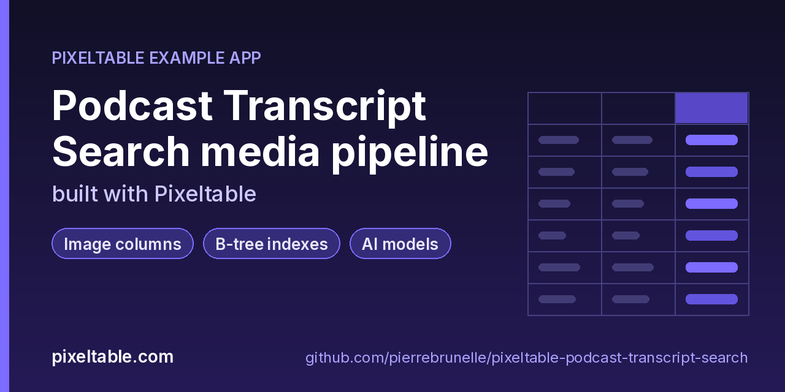

<!-- pixeltable-example-app: 20261017-podcast-transcript-search -->
# Build a searchable podcast and meeting transcript archive in Python

**Short answer:** put the episodes in a Pixeltable table and let computed columns do the rest. A view built with `audio_splitter` cuts each file into ~30 s segments (snapped to silence so words are not cut in half), a computed column calls the OpenAI Whisper API (`openai.transcriptions`, model `whisper-1`) on every segment, and an `EmbeddingIndex` over the transcript text makes `.similarity()` search return the episode and the mm:ss offset. New episodes are chunked, transcribed and indexed incrementally on insert, results are stored, and the same `app.py` runs locally or on Pixeltable Cloud: no Whisper batch scripts, no separate vector database.

**Replaces:** Whisper scripts + Deepgram + a vector DB



[](https://codespaces.new/pierrebrunelle/pixeltable-podcast-transcript-search?quickstart=1)
[](https://pixeltable.com)
[](https://pypi.org/project/pixeltable/)
[](https://github.com/pixeltable/pixeltable)
[](LICENSE)

`Episodes` holds one row per podcast episode or meeting recording (audio file + cover art). `Segments` is an `audio_splitter` view: ~30 s chunks with 1 s overlap, cut at quiet stretches (`min_silence_len=0.3`), each transcribed with the Whisper API and embedded with `text-embedding-3-small`; `at` is the mm:ss offset and `wpm` the speaking rate. `CoverTiles` is a `tile_iterator` view that cuts each cover into overlapping 256 px tiles and scores them with `image.entropy`, and `cover_faded` is a semi-transparent copy of the cover (the adjust-opacity cookbook as a UDF). `seed.py` loads three short synthetic episodes and a public-domain 1961 speech excerpt; `cli.py` searches, prints transcripts and lists episodes. No HTTP router.

[Pixeltable](https://pixeltable.com) is open-source, Python-native **multimodal AI data infrastructure**: tables, incremental computed columns, UDFs, indexes and serving in one library, running locally or on Pixeltable Cloud.

> ⭐ **Like this example?** Star [pixeltable/pixeltable](https://github.com/pixeltable/pixeltable) on GitHub. It helps other developers find it.

## What this example shows

- **B-tree indexes** declared on the model (`__indexes__`) back the lookup queries
- **Incremental computed columns** powered by plain Python UDFs (`@pxt.udf`)
- **Multimodal media columns** with configurable media destinations
- **Audio functions** from `pixeltable.functions.audio`
- **Iterators**: one input row fans out into many (frames, chunks, sentences) via a view
- **AI provider functions** as computed columns
- **Image functions** from `pixeltable.functions.image`
- **Importable UDF module**: UDFs live in `udfs.py`; tables and queries live in `app.py` (Pixeltable resolves UDFs by module path)
- **`pixeltable.toml`** declares a local database and a **Pixeltable Cloud** database, so the same code deploys with `pxt db update`

## How the pipeline is laid out

| Table | Built with | What it holds |
|---|---|---|
| `Episodes` | `pxt.Audio` + `pxt.Image` columns | one row per episode: audio, cover, `audio_meta`, `cover_thumb`, `cover_faded` |
| `Segments` | `audio_splitter(duration=30, overlap=1, min_silence_len=0.3)` | ~30 s chunks, Whisper transcript, `text`, `words`, `wpm`, `at` (mm:ss), embedding index `transcript_embed` |
| `CoverTiles` | `tile_iterator(tile_size=(256, 256), overlap=(32, 32))` | 16 overlapping tiles per 768 px cover with an entropy score |

Search is one query: `Segments.order_by(Segments.text.similarity(string=question, idx='transcript_embed'), asc=False).limit(k)`.

## Iterating on the schema

The app was built with the `pxt schema diff` / `update` loop. Adding a computed column (`preview`) is a safe, in-place change; editing a computed expression (the `cover_faded` opacity) is applied in place and `pxt recompute podcasts/episodes cover_faded -f` refreshes the stored values. A change that alters an inferred column type (for example a column that used to be `Float | None` and is now `Float`) is reported as unsupported: drop that one column from the SDK (`pxt.get_table('podcasts/segments').drop_column('wpm')`) and run `pxt schema update` again. Avoid naming a column `show`, which is reserved.

## Your own audio

Insert any mp3/wav/flac/m4a path or URL into `Episodes`; segmentation, transcription and indexing run on insert. For long recordings, `audio_splitter(max_size=24 * 1024 * 1024)` keeps every chunk under the Whisper API upload limit. To use a local model instead of the API, swap `openai.transcriptions` for `pixeltable.functions.whisper.transcribe` (needs `openai-whisper`).

## Demo audio

The three podcast episodes in `data/audio/` are synthetic (OpenAI text-to-speech from short scripts); `archive-jfk-1961-city-upon-a-hill.flac` is a public-domain excerpt of the January 9, 1961 address.

## What's inside

| File | What it is |
|------|------------|
| `.devcontainer/devcontainer.json` | GitHub Codespaces / Dev Container config: Python 3.12, installs `requirements.txt` |
| `.github/social-preview.png` | Social preview image (1280x640) |
| `CITATION.cff` | Citation metadata (authors, license, release date, keywords) |
| `app.py` | Tables declared as Python classes and `@pxt.query` functions |
| `cli.py` | Command-line front end for the transcript archive |
| `data/audio/archive-jfk-1961-city-upon-a-hill.flac` | Sample data |
| `data/audio/backfills-without-tears.mp3` | Sample data |
| `data/audio/saturn-small-telescope.mp3` | Sample data |
| `data/audio/why-sourdough-rises.mp3` | Sample data |
| `data/covers/arc-1961.png` | Sample data |
| `data/covers/kc-007.png` | Sample data |
| `data/covers/nsh-112.png` | Sample data |
| `data/covers/pn-041.png` | Sample data |
| `pixeltable.toml` | Project config: the local database plus a Pixeltable Cloud database (sizing, deploy excludes) |
| `seed.py` | Insert the demo episodes (three synthetic podcast episodes + a public-domain 1961 speech excerpt) |
| `udfs.py` | Pixeltable UDFs (`@pxt.udf`) in their own importable module, imported by `app.py` |
| `requirements.txt` / `pyproject.toml` | Dependencies (`pixeltable>=0.7.18`) |

**Tables**

| Table | Stored columns | Computed columns |
|-------|---------|------------------|
| `episodes` | `episode_id`, `show_name`, `title`, `published`, `audio`, `cover` | `audio_meta`, `cover_thumb`, `cover_faded` |
| `segments` | - | `transcript`, `text`, `words`, `at`, `wpm`, `preview` |
| `cover_tiles` | - | `detail` |

## Run in your browser (GitHub Codespaces)

[](https://codespaces.new/pierrebrunelle/pixeltable-podcast-transcript-search?quickstart=1)

1. Click **Open in GitHub Codespaces** above (or [this link](https://codespaces.new/pierrebrunelle/pixeltable-podcast-transcript-search?quickstart=1)). The dev container installs Python 3.12 and `pixeltable>=0.7.18` from `requirements.txt`.
2. In the codespace terminal, create the tables, seed them and run the app:

   ```bash
   pxt schema update app.py podcasts
   export OPENAI_API_KEY=...   # Whisper API (10 segments) + embeddings for the demo episodes
   python seed.py
   python cli.py search "how do I see the gap in Saturn's rings"
   python cli.py transcript kc-007
   ```


## Quickstart

Requires Python 3.11+ and `pixeltable>=0.7.18`.

```bash
git clone https://github.com/pierrebrunelle/pixeltable-podcast-transcript-search.git
cd pixeltable-podcast-transcript-search
python -m venv .venv && source .venv/bin/activate
pip install -r requirements.txt

# Create the tables in a local catalog directory named `podcasts`
pxt schema update app.py podcasts

export OPENAI_API_KEY=...   # Whisper API (10 segments) + embeddings for the demo episodes
python seed.py
python cli.py search "how do I see the gap in Saturn's rings"
python cli.py transcript kc-007
```

## Deploy to Pixeltable Cloud

The same `app.py` runs on [Pixeltable Cloud](https://pixeltable.com). Sign in (or get a free trial database with `pxt new`), point the second database entry in `pixeltable.toml` at your own database, then deploy:

```bash
pxt login                       # or: export PIXELTABLE_API_KEY=<your-api-key>
# edit pixeltable.toml: name = 'pxt://<your-org>:<your-db>'
pxt db update pxt://<your-org>:<your-db>                 # build the image and upload the project
pxt schema update app.py pxt://<your-org>:<your-db>/podcasts   # create the tables in the hosted database
```

Keep keys in environment variables or `pxt secret set`, never in code.

## Code walkthrough

**1. Business logic is plain Python, in `udfs.py`.** A `@pxt.udf` function can be used as a column expression. Pixeltable records UDFs by module path (`udfs.set_opacity`), so they live in their own importable module rather than inline in the app: the daemon, serving workers and Pixeltable Cloud import it again by that path.

```python
# udfs.py
@pxt.udf
def set_opacity(img: PIL.Image.Image, opacity: float) -> PIL.Image.Image:
    """Scale the alpha channel of an image (docs cookbook: adjust image opacity)."""
    img = img.convert('RGBA')
    alpha = img.split()[3].point(lambda p: int(p * opacity))
    img.putalpha(alpha)
    return img
```

**2. Tables are Python classes (`app.py`).** Annotated attributes are stored columns; attributes assigned an expression are **computed columns** (`transcript`, `text`, `words`, `at`, `wpm`, `preview`), evaluated incrementally on every insert or update and recomputed when their inputs change. Indexes live next to the columns.

```python
# app.py
class Segments(
    TableModel,
    name='segments',
    base=Episodes,
    iterator=pxtf.audio.audio_splitter(
        Episodes.audio, duration=30.0, overlap=1.0, min_segment_duration=4.0, min_silence_len=0.3
    ),
):
    """Component view: one row per ~30 s audio segment, transcribed with Whisper."""

    transcript = openai.transcriptions(audio_segment, model=TRANSCRIBE_MODEL)  # type: ignore[name-defined]  # noqa: F821
    text = transcript.text.astype(pxt.String)
    words = word_count(text)
    at = mmss(segment_start)  # type: ignore[name-defined]  # noqa: F821
    wpm = words_per_minute(words, segment_start, segment_end)  # type: ignore[name-defined]  # noqa: F821
    preview = snippet(text)

    __indexes__ = [
        pxt.EmbeddingIndex(text, string_embed=openai.embeddings.using(model=EMBED_MODEL), name='transcript_embed')
    ]
```

**3. Queries are functions (`app.py`).** `@pxt.query` wraps a Pixeltable query so it can be called from Python or exposed as a route:

```python
# app.py
@pxt.query
def search_transcripts(question: str, k: int = 5):
    """Top-k transcript segments closest in meaning to the question, with the mm:ss offset."""
    sim = Segments.text.similarity(string=question, idx='transcript_embed')
    return (
        Segments.order_by(sim, asc=False)
        .limit(k)
        .select(Segments.show_name, Segments.title, Segments.at, Segments.text, score=sim)
    )
```

## FAQ

**How do I build a searchable podcast and meeting transcript archive in Python?**

Clone this repo, `pip install -r requirements.txt`, run `pxt schema update app.py podcasts` and run the entry point (see Quickstart).

**What does this replace?**

Whisper scripts + Deepgram + a vector DB: storage, derived columns, indexes and retrieval are one Pixeltable table.

**Do I need a separate vector database for whisper api?**

No. Embedding indexes are declared on the table and kept up to date incrementally as rows are inserted or updated.

**Does it run locally and in the cloud?**

Yes. The same `app.py` runs against a local Pixeltable database or Pixeltable Cloud via `pixeltable.toml` (see Deploy to Pixeltable Cloud).

## Learn more

- 🌐 Website: https://pixeltable.com
- 📚 Docs: https://docs.pixeltable.com
- 💻 Source: https://github.com/pixeltable/pixeltable (⭐ star it if Pixeltable is useful to you)
- 📦 PyPI: https://pypi.org/project/pixeltable/
- 🧩 More example apps: https://pierrebrunelle.github.io/awesome-pixeltable-apps/

**[More Pixeltable example apps →](https://pierrebrunelle.github.io/awesome-pixeltable-apps/)**

---

<sub>Built as part of a daily series of Pixeltable example apps · Pixeltable 0.7.18 · Python, incremental computed columns · Licensed under Apache-2.0.</sub>
